[Chinese](./README.md)  |    [English](./README_english.md)

# WE 3D 渲染引擎 webGPU engine 3D

[](https://www.npmjs.com/package/we3d)


## ✨ 核心亮点

- **纯 WebGPU 原生引擎**：基于 TypeScript + WebGPU API 从底层独立设计与实现，无 WebGL 兼容层包袱，面向下一代 Web 图形标准。
- **Command 集合渲染架构**：以 Draw / Compute / Copy Command 集合统一提交 shader，底层抽象清晰、贴近 WebGPU 原生（架构参考 Babylon / three.js / Cesium / UE）。
- **ECS 贯穿全栈**：实体、材质、光影、摄像机、输入、动画、纹理统一以 ECS 管理，组合灵活、易扩展。
- **高级大气与云渲染**：内置实时积分 / Bruneton / Hillaire 三种大气方案，叠加体积云、丁达尔光效与云阴影。
- **体渲染双方案**：三维纹理采样与 ray march 实时计算，覆盖仿真与体渲染场景。
- **完整渲染特性**：前向 + 延迟双管线、多通道 GBuffer（单点 56bit）、IBL + SH、PCSS 软阴影、reversedZ、MSAA / FXAA、sRGB 与 Display P3 色彩空间。
- **GPU 拾取 + BVH 加速**：默认 GPU 拾取，CPU 侧 ray 配合 BVH 与物理引擎实现高性能拾取。
- **严谨工程化**：Vitest（Node + 浏览器真实 device）单测、Playwright 截图基线 e2e、ESLint / Prettier / Typedoc / CI 门禁，以 ESM + `.d.ts` 发布 npm。

WE3D包括基础引擎和编辑器两大部分。（目前WE3D处于初期开发阶段，功能、模块与结构会频繁调整。）

1. 基础引擎部分包括：核心功能、图形学功能、模型功能、物理引擎整合、动画管理五个模块。
本项目：https://github.com/WebgpuEngine/WE3D
当前开发版本文档：https://WebgpuEngine.github.io/WE3D
2. npm 包
    npm 安装： 
         npm i we3d
         npm i webgpu-we3d
    npm发布地址：
        https://www.npmjs.com/package/we3d
        https://www.npmjs.com/package/webgpu-we3d
    npm发布版本文档 https://webgpuengine.github.io/doc
3. doing ,示例代码  https://github.com/WebgpuEngine/example
4. doing ,演示Demo  https://github.com/WebgpuEngine/demo
5. todo,编辑器部分包括：材质编辑器、动画编辑器、场景编辑器，构建管理器四个模块，以实现可视化工作。在[https://github.com/WebgpuEngine/editor](https://)
6. todo,WE3D后期还会考虑减少后端服务，以实现支持服务器端活链接、USD、Nerf工作流、三维重构等以及AI适配等。

# 引擎基础说明

* WE 3D是使用typescript 和webGPU API 开发的web 端三维渲染引擎
* 在引擎基础部分涵盖场景、实体、纹理、材质、摄像机、光源、阴影、后处理、ECS、GPU拾取、AA、颜色空间、tonemapping、延迟渲染、BVH等；
* 在图形学的功能包括：IBL、SSGI、SSR、SSAO等
* 在物理引擎 上使用rapier进行物理引擎工作；
* 在模型部分：涉及gltf、obj、fbx等模型；
* 动画管理部分涵盖:关键帧、骨骼动画、变形目标、粒子系统等；
* 在渲染引擎的架构上是从底层独立设计与实现的，参考了Babylon、three、cesium、UE等；
* 在底层机制以command集合（Draw Command、Compute Command、Copy Command）进行shader提交；
* 在更新机制与事件机制上，以ECS为核心机制以及Event处理；

# 更多功能说明

* 支持sRGB和display P3的颜色空间，WE3D内部以linear的线性空间进行工作，支持多种模式的色彩映射输出；
* 光源支持环境光、方向光、点光源、聚光灯、面积光；
* 阴影实现以shadow map基础，支持PCSS;
* 在深度上支持正向Z和reveredZ，默认开启reversedZ;
* 支持MSAA，FXAA，并预计实现TAA。目前MSAA与延迟渲染不能同时使用（后期可能改进边缘检测后，支持同时使用）；
* 渲染模式支持前向渲染和延迟渲，透明物体渲染支持alpha透明和物理透明；
* 在渲染的GBuffer使用了多通道（单点56bit），数据覆盖color、depth、position、normal、albedo、roughness、metallic、ao、emissive、material、id等；
* 实体上支持mesh、lines、points，sprite，并支持实例化，在数据属性多种形式的属性组合的数组形式和ArrayBuffer形式数据；
* 在模型上支持gltf、obj、fbx等（进行中）。同时支持仿真数据、体渲染数据，并预计支持地理空间数据(todo);
* 材质支持简单材质、blinn-phong、PBR 材质；
* 摄像机支持正交与透视，且支持viewpot模式，多摄像机，多视图等；
* 拾取(pickup)支持两种模式，GPU端和CPU端，默认使用GPU端的拾取功能，CPU的ray功能配合BVH和物理引擎实现；
* 物理引擎整合rapier为主（进行中）；
* 渲染管理器内部支持多通道，涉及：计算、纹理、材质、渲染目标、不透明阴影、透明阴影、深度、MSAA、前向渲染、延迟渲染、透明渲染、sprite、sprite透明、toneMapping、后处理、ui、stage等诸多通道。各个通道会包括有内容线和时间线两种工作模式；
* 后处理是在有管理器和后处理功能组成，目前有FXAA，blue，colordemo等；
* stage有四个：默认的world，ui、stage1(导航等)，stage2（地图等）；
* ECS应用的比较多，比如实体、材质、光影、摄像机、输入管理、动画、纹理等都是采用的ECS的概念进行管理；
* 动画系统包括：关键帧(keyFrame)、变形目标(mophTarget)、骨骼动画、以及通过物理引擎实现的物理驱动动画；
* 体渲染材质有两个落地方案，一个是三维纹理的方案（3D采样），另一个是ray march的shader方案（实时计算）；
* 大气层方案，有实时积分方案，Bruneton方案，Hillaire方案；
* 在大气层上叠加的还有体积云，丁达尔光效，云阴影等；
* todo：粒子系统、SSGI、SSR、SSAO、TAA、

## 快速开始

安装：

```bash
npm i we3d
```

在 HTML 中准备一个 canvas，并通过 ES Module 引入引擎：

```html
<canvas id="render"></canvas>
<script type="module" src="./main.ts"></script>
```

`main.ts` —— 初始化场景、相机与第一个网格：

```ts
import {
    initScene,
    PerspectiveCamera,
    BoxGeometry,
    ColorMaterial,
    Mesh,
} from 'we3d';

// 1. 初始化场景（绑定 <canvas id="render">）
const scene = await initScene({
    initConfig: {
        canvas: 'render',
        backgroudColor: [0, 0, 0, 1],
    },
});

// 2. 创建透视相机（arcball 控制器）
const camera = new PerspectiveCamera({
    fov: (2 * Math.PI) / 5,
    aspect: scene.aspect,
    near: 0.01,
    far: 100,
    position: [0, 0, 3],
    lookAt: [0, 0, 0],
    controlType: 'arcball',
});
await scene.add(camera);

// 3. 几何体 + 材质 + 网格实体
const boxGeometry = new BoxGeometry();
const colorMaterial = new ColorMaterial({ color: [0, 0.1, 0.2, 1] });
const mesh = new Mesh({
    attributes: { geometry: boxGeometry },
    material: colorMaterial,
});
await scene.add(mesh);
```

> 更多可运行示例见下方「简单示例」及 [`e2e-cases/`](./e2e-cases) 目录；完整 API 速查见 [`design/workBuddy/core/03-API速查手册.md`](./design/workBuddy/core/03-API速查手册.md)。

## 特性一览

> 状态说明：✅ 已实现 · 🔄 进行中 · 🕓 规划中（避免将规划项误读为已落地能力）

| ✅ 已实现 | 🔄 进行中 | 🕓 规划中 |
| --- | --- | --- |
| sRGB / Display P3、linear 工作流、多模式 toneMapping | 物理引擎（rapier） | TAA |
| 环境光 / 方向光 / 点光 / 聚光 + PCSS 软阴影 | gltf / obj / fbx 模型 | SSGI / SSR / SSAO |
| 前向 + 延迟双管线、多通道 GBuffer（单点 56bit） | 面积光 | 粒子系统 |
| IBL + SH、体渲染（3D 纹理 / ray march） | 物理透明 / A-Buffer | 流体系统 |
| 大气三方案 + 体积云 + 丁达尔 + 云阴影 | 仿真数据 / 地理空间 | 编辑器（材质/动画/场景/构建管理器） |
| MSAA / FXAA、reversedZ（默认） |  | 服务端活链接 / USD / Nerf / 三维重构 / AI 适配 |
| 骨骼动画 / 变形目标 / 关键帧 / 物理驱动动画 |  |  |
| GPU 拾取 + BVH、1024 光源、ECS 全栈管理 |  |  |

# 简单示例

| ReversedZ                                         | material alpha blend                             | pixel level alpha transparent material           |
| ------------------------------------------------- | ------------------------------------------------- | ------------------------------------------------- |
| 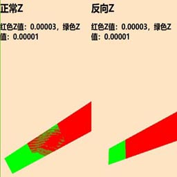 | 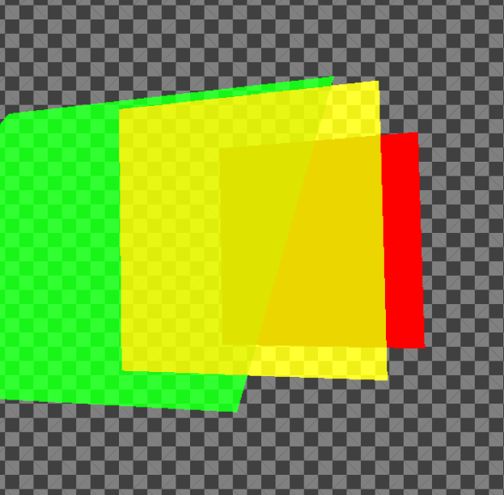 | 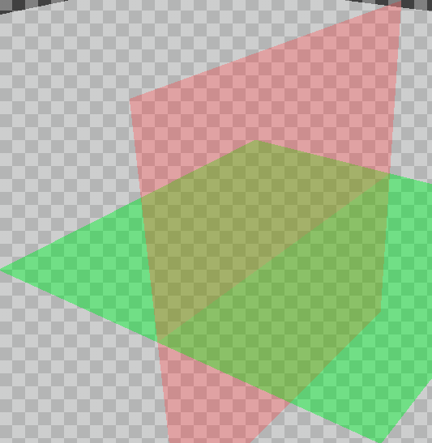 |
| 高光纹理 specular texture                         | 视差纹理 parallax texture                         | 法线纹理 normal texture                           |
| 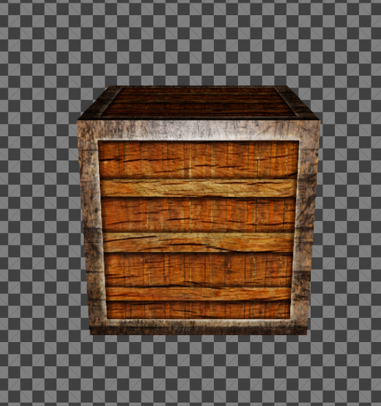 | 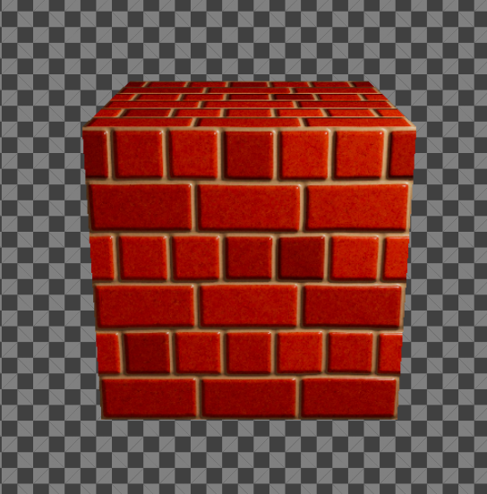 | 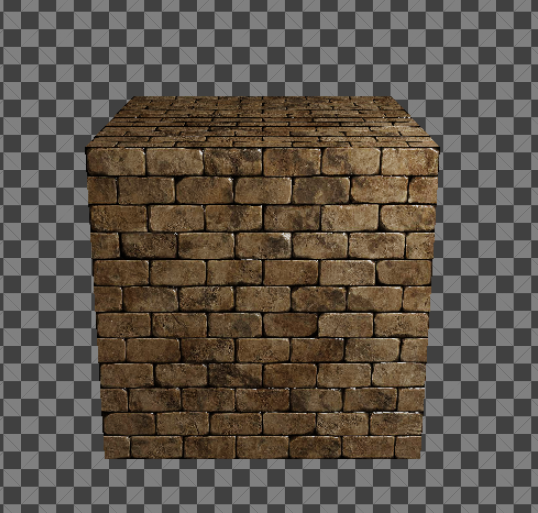 |
| direction light +PCSS shadow                      | point light+PCSS shadow                           | spot light +PCSS shadow                           |
| 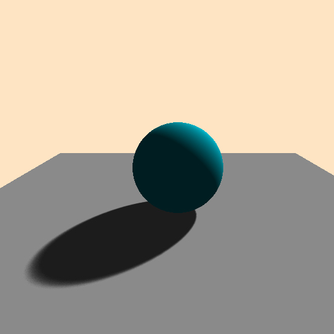 |  | 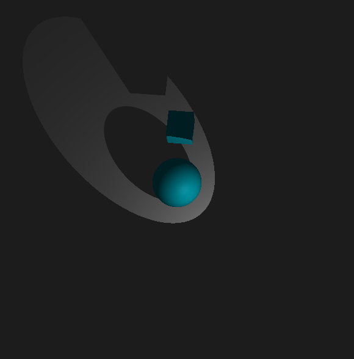 |
| 点光源+视差纹理                                   | viewpot                                           | PBR                                               |
| 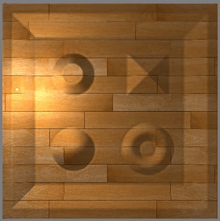 | 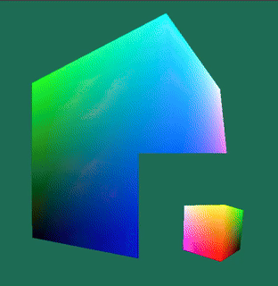 | 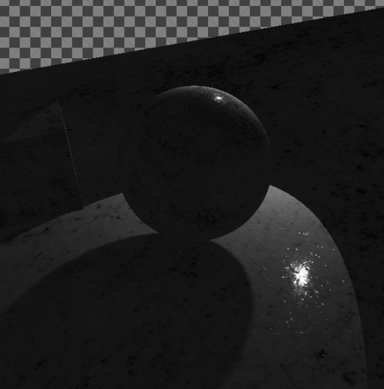 |
| PBR                                               | PBR+spot+shadow                                   | PBR+point light+shadow                            |
| 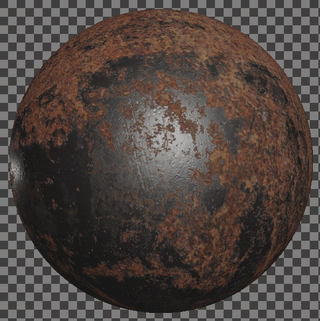 | 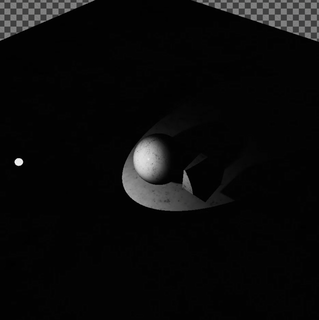 | 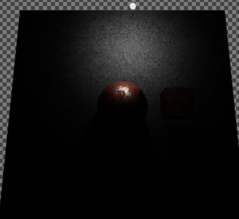 |
| 1024个光源                                        | MSAA                                              | FXAA                                              |
| 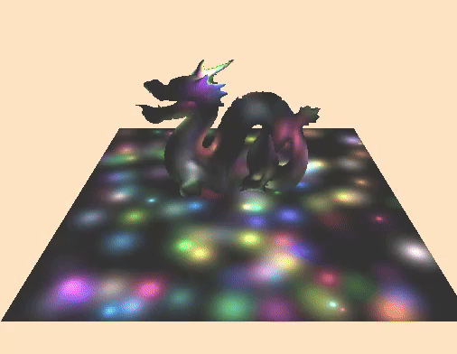 | 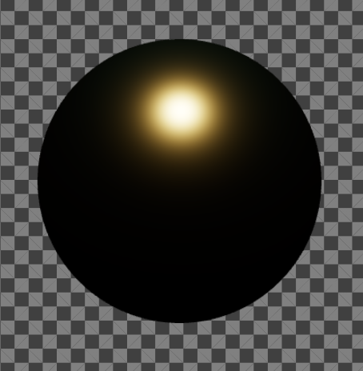 | 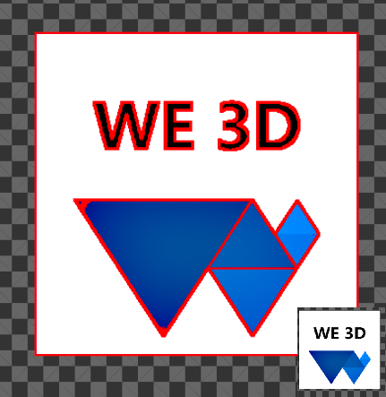 |
| post process blue 3*3                             | post process red to 1                             | 延迟渲染 deferRender：PBR                         |
| 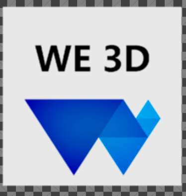 | 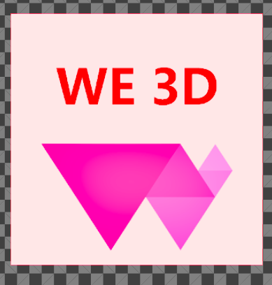 | 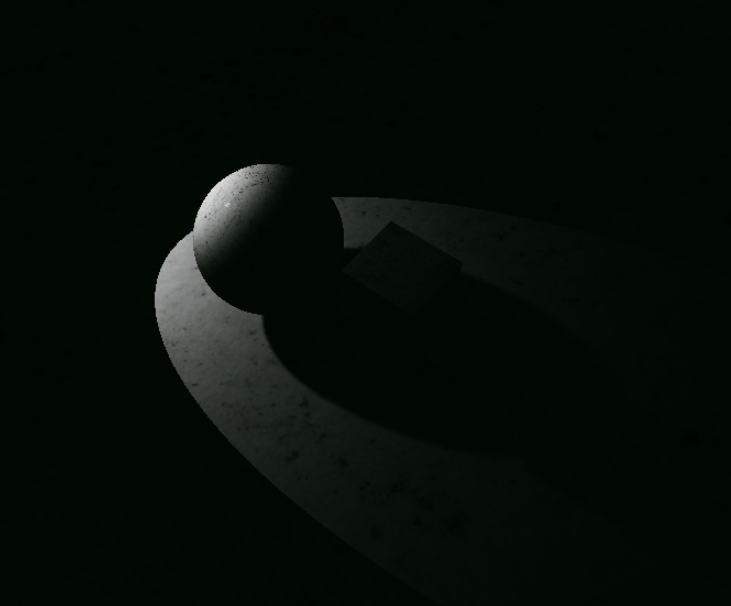 |
| 延迟渲染 deferRender：PBR                         | 延迟渲染 deferRebder：BlinnPhong                  | 延迟渲染 deferRebder：BlinnPhong                  |
| 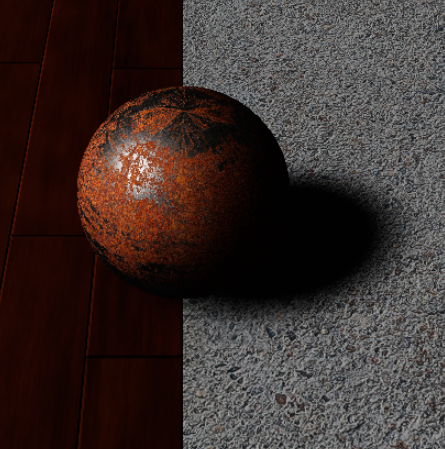 | 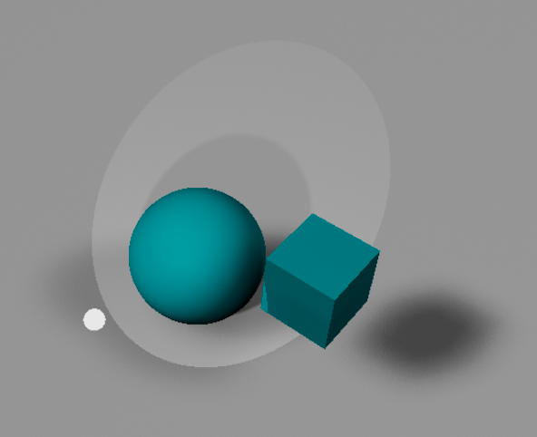 | 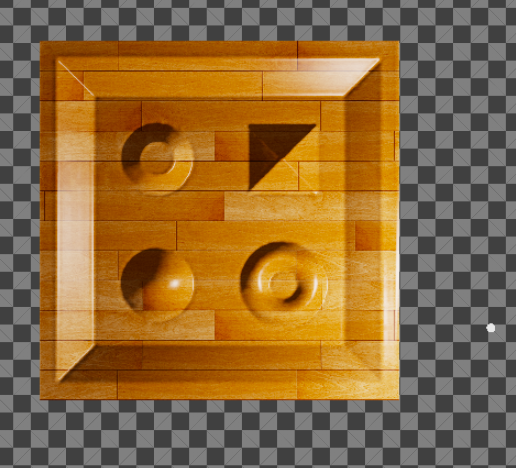 |
| 骨骼动画 skeleton                                 | 变形目标 morph target                             | gltf Fox 骨骼动画                                 |
|  |  |  |
| gltf Hen 骨骼动画                                 | gltf LittlestTokyo                                | rapier demo with WE3D                             |
|  |  |  |
| PBR+IBL+SH                                        | PBR+IBL+SH+预览波+天空盒                          | 体渲染  3D 纹理                                  |
|  |  |  |
| 体渲染 ray march                                  | 大气层 实时积分计算                               | 大气层 Bruneton                                  |
|  |  |  |
| 大气层 Hillaire LUT                              | 大气层 Hillaire ray march                        | 体积云                                            |
|  |  |                                                   |
| 大气层+云                                         | 大气层+云+阴影                                    | 大气层+云+丁达尔+云阴影                           |
|                                                   |                                                   |                                                   |
| SSAO                                              | SSGI                                              | SSR                                               |
|                                                   |                                                   |                                                   |
| 仿真云图                                          | 仿真等值线体渲染                                  | 仿真流线                                          |
|                                                   |                                                   |                                                   |
| clip 全局                                         | clip 局部                                         | clip sdf                                          |
|                                                   |                                                   |                                                   |
| 面积光                                            | 物理透明                                          | A-Buffer                                          |
|                                                   |                                                   |                                                   |
| 粒子系统                                          | 流体系统                                          |                                                   |
|                                                   |                                                   |                                                   |

## 项目结构与开发环境

**源码组织**（核心引擎位于 [`src/we/core`](./src/we/core)）：

| 模块 | 职责 |
| --- | --- |
| `scene` / `organization` / `entity` | 场景、节点空间（ECS）、实体（Mesh/Lines/Points/Sprite） |
| `command` / `commandInfo` | Draw / Compute / Copy Command 集合与生成器（底层渲染抽象） |
| `material` / `texture` / `geometry` / `shaders` | 材质（PBR/BlinnPhong/Color…）、纹理/立方体贴图/HDR、几何体、WGSL |
| `camera` / `control` / `light` / `shadow` | 相机、控制器、光源与阴影 |
| `ibl` / `gbuffers` / `postprocess` / `pickup` | IBL、延迟渲染 GBuffer、后处理、GPU/CPU 拾取 |
| `animation` / `particle` / `physics` | 关键帧/骨骼/变形目标、粒子、rapier 物理 |
| `atmosphere` / `SHR` | 大气三方案、球谐 |
| `math` / `base` / `resources` | 数学库、基础类型、资源/缓冲管理 |

**运行环境要求**：
- 需要支持 **WebGPU** 的浏览器（如 Chrome / Edge 113+，或开启 WebGPU 的 Firefox / Safari 技术预览）。
- 本地开发通过 `npm run dev`（Vite）启动；WebGPU 在 `http://localhost` 下可用，部署到公网需 **HTTPS** 或 `localhost`。
- 需 Node.js 用于构建 / 测试 / 文档生成（依赖版本见 `package.json` `devDependencies`）。

**规划路线（Roadmap）**：
- 物理引擎整合（rapier）、gltf/obj/fbx 模型加载完善；
- 面积光、物理透明、A-Buffer；
- 全局光照（SSGI / SSR / SSAO）、TAA、粒子与流体系统；
- 仿真数据 / 地理空间数据支持；
- 可视化编辑器（材质 / 动画 / 场景 / 构建管理器）；
- 服务端活链接、USD / Nerf 工作流、三维重构、AI 适配。

# 工程化与开发约定

* 目录结构约定、AI 工作约定、开发流程与发布约定见 [AGENTS.md](./AGENTS.md)。
* 工程化方案（vitest / ESLint / Prettier / Playwright / CI / lib 打包）见 [design/engineering-plan.md](./design/engineering-plan.md)。
* 已知缺陷与修复路线见 [design/workbuddy/core/04-问题缺陷与改进建议.md](./design/workbuddy/core/04-问题缺陷与改进建议.md)。
* 提交 git 前必须跑 e2e 验证（或 Playwright 关键示例），防止源码改动破坏正常功能。
* 包名 `we3d`，以 lib 形式（ESM + `.d.ts`）发布到 npm，不做 web app 打包。

# 资料参考与推荐

* webGPU标准：<https://www.w3.org/TR/webgpu/>
* WGSL的标准：<https://www.w3.org/TR/wgsl/>
* 非常好示例：<https://github.com/webgpu/webgpu-samples>
* google的Dawn：<https://github.com/google/dawn>
* Mozilla的wGPU：<https://github.com/gfx-rs/wgpu>
* MDN的webGPU文档：<https://developer.mozilla.org/zh-CN/docs/Web/API/WebGPU_API>
* 非常好的webGPU教程：<https://webgpufundamentals.org/>
* 非常好的webGL2教程：<https://webgl2fundamentals.org/>
* 非常好的webGL1教程：<https://webglfundamentals.org/>
* dawn 的C示例：<https://github.com/samdauwe/webgpu-native-examples>
* 非常实用的JS端的图形学简单数学库，这是目前主要使用的库：<https://github.com/greggman/wgpu-matrix>
* 另外一个经典的图形学数学库：<https://github.com/toji/gl-matrix>
* webGPU Samples <https://webgpu.github.io/webgpu-samples/>
* WebGPU API reference，方便实用：<https://gpuweb.github.io/types/index.html>
* webgpu-utils可以参考一下：<https://github.com/greggman/webgpu-utils>
* filament可以学习与参考一些：<https://github.com/google/filament>
* PBRT书籍，非常好：<https://www.pbr-book.org/>
* Ray tracing的书籍：<https://raytracing.github.io/>
* nvidia的书籍：<https://developer.nvidia.com/gpugems/gpugems/contributors>
* gltf文档 <https://registry.khronos.org/glTF/specs/2.0/>
* gltf tutorials  <https://github.com/KhronosGroup/glTF-Tutorials>
* rapier [Rapier physics engine | Rapier](https://rapier.rs/)
* [Bullet Real-Time Physics Simulation](https://pybullet.org/wordpress/)  <https://pybullet.org/>
* CSS Color Module Level 4 <https://www.w3.org/TR/css-color-4/>
* Self Shadow  <https://blog.selfshadow.com/>
* bruneton大气层： <https://ebruneton.github.io/precomputed_atmospheric_scattering/>
* Hillaire大气层方案的webgpu实现：<https://github.com/JolifantoBambla/webgpu-sky-atmosphere>
* Sebastien Hillaire的 Unreal Engine 示例仓库，<https://github.com/sebh/UnrealEngineSkyAtmosphere>
*
