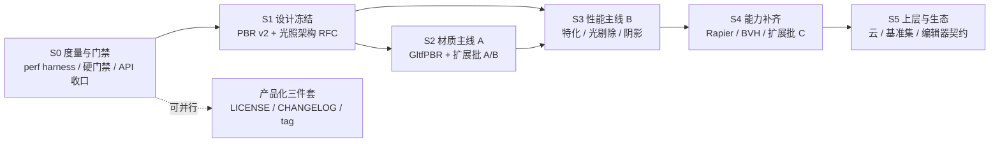

# WE3D 下一步开发方向：分析与建议（2026-11-18）

> **文档性质**：方向级决策建议（不是实施级方案）。只做现状盘点、价值判断、优先级排序与阶段划分；不含代码改动，不替代各方向的 RFC。
> **依据**：当前仓库源码、`package.json`、`README.md`、`AGENTS.md`、`design/appraisal/WE3D-独立项目评估-20261118.md`、`design/engineering/meta/pending-work.md`、`design/shaders/*`、`design/gltf/gltfTransform/*` 等既有文档。证据索引见附录 A。
> **基线**：`we3d@0.0.3`；`src/we` 227 个生产 `.ts` + 89 个 WGSL；单测 164 + 浏览器测试 76；e2e 15 类 89 用例 / 89 张 GPU 基线；`npm run ci:no-e2e` 全绿。
> **范围**：回答「8 个方向怎么选、怎么排、先做什么、不建议做什么」，并补充第 8 项。
> **决策状态（2026-11-18）**：§十 D1–D7 已由用户逐条拍板（D1 冻结推迟到 S1、D2 同意、D3 性能对照口径推迟到 demo 对比、D4 样本资产 + 截图基线可用且需对齐官方资产/相机 JS、GLSL 扩展以原理参考为主、D5 同意、D6 同意且仅规划、D7 不引入云端 e2e），正文相关表述已同步；以 §十「用户拍板」列为准。
> **实施状态（2026-11-27 更新）**：S0（度量与门禁）主体已落地，逐项进度以 `s0/S0-工作方案.md` §六为准；perf harness 已含 `GpuProfiler` 双缓冲连续采样（提交 `a0665c2`），实现记录见 `s0/perf-harness-implementation.md`。S1（设计冻结）工作方案已定稿（`s1/S1-工作方案.md`），确立 glTF 官方强制依据（§十一 / D8）与扩展取舍表两期拍板（D9），本地资料库规划见 `s1/local-reference-library.md`。正文中的「当前状态」/「现状」表述（含 §八表格、J2、8.1 行）均为 2026-11-18 盘点快照，不覆写；后续实测数据以 §八的「状态更新（2026-11-27）」表与各阶段工作方案为准。

---

## 一、结论先行

**一句话主张：不要 8 个方向平行推进。选一条主线——「以 glTF 内容为牵引，重建材质与光照/性能基线」，把 WE3D 从『能力广但不可承诺』推到『同一份内容能正确、可度量地渲染』；物理、大气云、编辑器、demo 都排在这条主线的下游。**

理由：用户列出的 8 项并不平级，实际可归为三类：

| 类别 | 包含方向 | 性质 | 处理策略 |
| --- | --- | --- | --- |
| **地基** | 4（PBR 性能）、补充：度量体系 / 门禁 / API 边界 | 决定其余所有方向「改完有没有变好、有没有回归」 | **必须先做**，且尽量不改变视觉 |
| **主线** | 2（glTF 扩展）、3（glTF PBR 重构）、部分 4（光照架构）、6（基准场景集） | 决定引擎对外最重要的能力：把一份标准 glTF 资产正确且高效地渲染出来 | **集中投入，一次设计、分阶段实现** |
| **能力补齐 / 上层** | 1（Rapier）、5（大气与云）、7（编辑器）、6（纯 demo 移植） | 扩大能力面，但当前都建立在「地基不稳」之上 | **后置，且各自限定为最小闭环** |

**推荐顺序（摘要）**：

| 顺序 | 阶段 | 核心交付 | 优先级 |
| --- | --- | --- | --- |
| S0 | 度量与门禁 | 性能基准 harness、GPU timestamp profiler、门禁硬化、产品化三件套 | **P0** |
| S1 | 设计冻结 | 一份《glTF PBR v2 + 光照架构》RFC、材质 schema、扩展矩阵、变体矩阵，**并在此时把既有 PBR 冻结为 legacy**（§十 D1：目前不冻结） | **P0** |
| S2 | 材质主线 A | `GltfPBRMaterial` 新族 + 批 A/B 扩展 + Khronos 视觉回归（legacy PBR 已于 S1 冻结） | **P1** |
| S3 | 性能主线 B | 编译期特化、clustered/tiled 光源剔除、阴影动态化、perf 门槛 | **P1** |
| S4 | 能力补齐 | Rapier 刚体/碰撞体闭环 + e2e、BVH/CPU 拾取、批 C 扩展 | **P2** |
| S5 | 上层与生态 | 大气/体积云生产化、基准场景集、编辑器契约与最小原型 | **P2 / P3** |

> 与既有文档的关系：`design/appraisal/WE3D-独立项目评估-20261118.md` §八的 P0/P1（门禁、API 边界、质量收敛、产品化）被整体折叠进 S0；其 P2（物理、BVH、粒子、渲染特性）被拆到 S2/S3/S4。本文不推翻该评估，而是把用户提出的 8 个功能方向**接到同一条优先级轴上**。

---

## 二、现状事实盘点（先把地摸准）

### 2.1 逐方向现状

| # | 方向 | 代码现状 | 真实缺口 |
| --- | --- | --- | --- |
| 1 | Rapier 整合 | **独立 demo 复刻已跑通**：`examples/physics/rapier/base/` 8 文件、`cloneDemo3D/` 35 文件（17 个 demo builder）；`@dimforge/rapier3d ^0.19.2` 已是 production 依赖并 external 化 | 引擎层 `src/we/core/physics/` 仅 4 文件约 3 KB（`rigidBody.ts` 48 B、`colliderBody.ts` 51 B 为空类，`physicModel.ts` 全 throw）；无 PhysicsWorld、无刚体/碰撞体组件、无通用 Transform 同步回路；**物理类 e2e = 0**。demo 内是手工 `collider.translation() → NodeObject.Position` 同步 |
| 2 | glTF 扩展 | 核心 glTF 2.0 已迁移到 `@gltf-transform/core@4.5.1`，双层视图（裸 JSON + Document）；已支持 Draco / meshopt / KTX2(Basis) / WebP 四类**容器与压缩**扩展；`extensionDependencies.ts` 有通用 provider 注册点 | `KHR_materials_*` 全系列、`KHR_texture_transform`、`KHR_lights_punctual`、`KHR_materials_variants`、`EXT_mesh_gpu_instancing`、`KHR_animation_pointer` **全部零实现**；getter 全返回裸 JSON、`materials[].extensions` 从未被读；`extensionsRequired` 无白名单/拒载校验（声明必需扩展会静默渲染错）；相机 `initCamerasForInstance()` 为空、灯光完全未读、morph NORMAL/TANGENT 与 JOINTS_1+ 未支持 |
| 3 | PBR TS 结构 | **现有 `PBRMaterial` 已经完全绑定 glTF metallic-roughness**：`IV_PBRMaterial` 逐字段对应 `baseColorFactor`/`metallicRoughnessTexture`(B/G)/`occlusion`/`normal`/`alphaMode`/`alphaCutoff`/`emissive`；5 个 SHR 别名 `material.pbr.{forward,defer,Msaa,MsaaInfo,blend}` | 所谓「其他 PBR 的判断」不是 OpenPBR/扩展分支，而是 **uber shader 的运行时分支**：`PBR.fs.wgsl:61-217` 对 12 个参数逐个 `if(kind)`、`PBRMaterial.ts:465-653` 的 TS 参数化 if/else 链、`deferRender.fs.wgsl` 每光源循环内的 `materialKind` 分支。OpenPBR、spec-gloss 均为 0 实现 |
| 4 | PBR 效率 | IBL **其实已实现**：`core/ibl/`、`ibl_fn.wgsl`（三阶 SH + Filament 缩放）、预滤波 cubemap + DFG LUT（加载预烘焙 KTX1，非运行时预滤波）、`PBRfunction.wgsl:106-127` 已使用 | 前向/延迟两条路径都是**每像素循环全部光源**，且循环内走 PCSS（100 样本 × 10 rings）；无 tiled/clustered/light culling；无 GPU timestamp/profiler；无 LOD、无真实视锥剔除（3 个 `getVisibleInBVH()` 均 `return true`）；FS 参数分支未编译期特化；GBuffer 4 attachments；shadowmap 固定 1024² 且每灯按 6 面预留 |
| 5 | 大气 / 云 / 光影 | 大气 **Hillaire LUT 管线接近真实**：transmittance / multiple scattering / sky-view / AP / shadowmap LUT + WGSL 齐备；阴影 PCSS 真实实现且与大气 LUT 有结合 | 体积云与代码事实一致——**只是论证**：仅 `I_AtmosphereCloudParams` 接口与 `clouds?` 字段，无任何 TS 消费，shader 中 cloud 只出现在注释；examples 里是独立论证 demo（ShaderToy/volume、Bruneton/HillaireRebuild）。大气自身也有 todo（日月阴影「wgsl 中未实现，暂时注解掉」、skyview/AP 更新条件、单位 m⁻¹/km⁻¹ 混乱） |
| 6 | 精品 demo | `examples/files.json` 约 90 个分类组；e2e 89 用例（glTF 约 30 为最大类）；已有 three.js 几何体 / FXAA、Rapier testbed、Shadertoy、Bruneton GLSL 的移植痕迹 | `graphics/`、`BVH/`、`editor/`、`webGPU/`、`particles/` 为空占位；没有**统一口径的对照基准**（同资产 / 同相机 / 同光照 / 同分辨率），现有 demo 无法回答「比 three.js 快还是慢」 |
| 7 | 编辑器 | `examples/editor/index.html` 只有 6 个 `href=""` 占位；`NodeObjectJSON`、`IJ_Scene` 两份 JSON 类型存在 | `src/we` 内无 editor / undo / redo / serialize / deserialize；`initSceneConfig.loadConfig` 被注释、`PhysicalModel.saveJSON/loadJSON` 全 throw；**无统一材质参数 schema**（参数散落在各 `IV_*` 接口 + uniform 指针）；无 Inspector 反射；UI 依赖只有示例级 `lil-gui` / `muigui` |
| 8 | 补充 | 见 §五 | 见 §五 |

### 2.2 三处需要修正的认知（会直接改变方案）

1. **「three.js 用 IBL、WE3D 用多光源，所以占用率 30% vs 70%」这个对比口径不成立为性能结论。**
   - WE3D 自己就有 IBL + SH + DFG LUT，Tokio（`examples/model/gltf/base/draco/LittlestTokyo.ts`）未走 IBL 是**场景配置选择**，不是引擎能力缺失。
   - 一边是「1 个环境光 + 预滤波」，另一边是「N 个光源 × 每像素循环 × PCSS」，两者计算量本就不同量级；「占用率」也不是性能指标（低端 GPU 上 70% 占用可能反而说明 GPU 利用率高）。
   - **正确做法**：S0 先建同口径 harness（同资产 / 同相机 / 同分辨率 / 同光照方案：① 都 IBL-only ② 都 N 个动态光），测 CPU frame time、GPU frame time、drawcall、带宽/显存，再谈优化。当前 30/70 只能作为「待复现的现象」，不能作为目标函数。
2. **「重新设计一个 glTF PBR、不改造现有 PBR」在流程上也是最省的路径。** 现有 PBR 被 89 张 GPU 基线 + 5 个 renderMode 变体 + 延迟 GBuffer `materialKind=1` + glTF 默认材质路径锁定；原地加 `KHR_*` 分支会同时引爆 shader 分支、bindgroup 布局、基线重出与延期。**新材质走新 SHR 别名 ⇒ 已有 89 张基线零改动**，只需为新增用例出基线。
3. **「参考 glTF 官方代码（js + glsl）」不能理解为直译。** 仓库内 0 个 `.glsl` 文件，官方仅以 npm 依赖（glTF-Transform）、Khronos 样本资产、Basis/Draco 解码器资源形式存在；glTF-Sample-Viewer 的 GLSL 是 **WebGL2 uber shader**，其扩展用编译期宏组合、IBL 用离线预滤波工具链，与 WE3D 的手动 bindgroup layout + SHR 预处理 + 前向/延迟双管线不兼容。**用户拍板（§十 D4）的引入形态**：样本资产与截图基线可以使用，但须一并对齐官方的资产、相机等 JS 内容才能保障 A/B 一致性；GLSL 扩展实现**需要参考、以原理为主**（作语义与数值 oracle），不直译、不 vendor 进 `src/we`。照搬 GLSL 会引入一套无法维护的第二渲染契约。

---

## 三、七条关键判断

**J1 · 方向不是 8 个，是 1 条主线 + 1 个地基 + 一批下游。** 同时开 glTF 扩展、PBR 重构、体积云、编辑器、物理，会让 89 张 GPU 基线反复重出、`check:exports` 与 barrel 反复改、SHR 别名矩阵膨胀，且没有任何一项能被量化验收。

**J2 · 性能问题的第一优先级是「可复现度量」，不是「改 shader」。** 当前无 `createQuerySet`/`resolveQuerySet`/`writeTimestamp`（仅 `scene.ts:139` 请求了 `'timestamp-query'` feature）、无 drawcall/带宽统计、无 perf 回归门槛。在这种状态下做优化，无法区分「真的快了」与「换了台机器 / 换了渲染路径」。S0 的 perf harness 是 S3 一切优化的前置。

**J3 · PBR v2 的正确形态是「新材质族 + 共享 BRDF 库 + 编译期变体」，不是「再复制一份 PBRMaterial」。**
- 新建 `GltfPBRMaterial` + `shaders/material/gltfPBR/*`，注册 `material.gltfPbr.*` 别名；现有 `material.pbr.*` 于 S1 冻结为 legacy（§十 D1：目前不冻结，冻结前仅收 bugfix；继续服务非 glTF 与既有基线）。
- 把 GGX/Smith/Schlick/IBL 组合抽成共享 WGSL include（纯函数、无 bindgroup 依赖），两份材质共用，避免 BRDF 二义。
- TS 侧分层：**材质描述（glTF JSON → 规范化的 feature set + uniform 值）** 与 **GPU 实现（feature mask → 变体 key → bindgroup/WGSL 拼接）** 分离；用 feature mask 生成编译期特化，取代 `if(kind)` 逐像素分支。
- 变体必须设上限与 fallback：组合数超过阈值时回退到 uniform 分支，避免 `N 扩展 × 5 renderMode × 前向/延迟` 的变体爆炸与 pipeline LRU(60) 抖动。

**J4 · glTF 扩展要按「消费点」分批，而不是按扩展名字逐个做。** 现有 `WebIO.registerExtensions(ALL_EXTENSIONS)` 已把扩展**解析**进来，瓶颈是**没有消费点**（`materials[].extensions` 从不读、getter 返回裸 JSON）。因此第一步是建立「扩展解析 → 材质 feature set」的单一入口，并把 `extensionsRequired` 变成硬校验；之后每加一个扩展只是往同一入口加一条映射 + 一个 e2e 用例。

**J5 · 光照架构必须与 PBR v2 一起设计，不能事后补。** `KHR_materials_transmission` / `volume` / `sheen` / `clearcoat` 都会改变「每像素需要哪些光照与采样」；若先做 PBR v2 再引入 clustered/tiled culling，等于把 `calcLightAndShadowOfPBR` 重写两遍。S1 的 RFC 必须同时定死：光源数据结构、剔除方案、shadow 绑定、GBuffer 中 `materialKind` 的编码、前向/延迟共用路径。

**J6 · 编辑器后置，但它的「契约」必须前置。** 材质参数 schema、场景 JSON round-trip、undo/redo 命令模式、Inspector 反射协议，是 S2/S4 的副产物（做新材质族与物理组件时顺带定义）。若等到 S5 才定，编辑器会倒逼引擎二次重构。

**J7 · Rapier 适配是「能力补齐」，不要升级成 ECS 重构。** 引擎并非标准 ECS（`ECSManager` 是对象池 / 统一更新口，`NodeObject` 才是场景节点），现成挂接点是 `NodeObject._physicBody`、`E_BVHSpaceType`、`IJ_Scene.physicsEngine/physicsEnabled`。目标是「刚体 + 碰撞体 + 固定步长 + 单向 Transform 同步 + 事件 + e2e」的最小闭环，不是引入 Component/Archetype 体系。

---

## 四、逐方向建议

### 方向 1 · Rapier 整合 → **S4，P2**

| 项 | 建议 |
| --- | --- |
| 目标 | 从「demo 能跑」到「引擎 API 可用」：`PhysicsWorld` / `RigidBody` / `Collider` / 固定步长 step / 碰撞事件；物理 e2e ≥ 3 |
| 落地形态 | `core/physics/` 补实 4 个占位文件；`IJ_Scene.physicsEnabled` 驱动 world 生命周期；`NodeObject._physicBody` 挂载组件；同步策略**默认物理→渲染单向**（kinematic / trigger 走显式反向写回），避免双写震荡；复用 demo 中 `listOfColliderToNodeObject` Map 思路 |
| 依赖 | rapier wasm 异步 init（当前 external，需在 lib 使用者侧可配置）；glTF 实例 / 多 skin 的 collider 绑定放二期 |
| 验收 | 刚体下落、trimesh 碰撞、凸包/heightfield、CCD 各 1 例；固定步长在 30/60/144Hz 下行为一致；`npm run ci` 全绿（新增基线） |
| 风险 | 物理与动画/骨骼同时写 Transform；wasm 加载与 `test:browser` / Playwright 的资源路径；不要把 demo 的 `Graphics.ts` 整体搬进 `src/we` |
| 为何不更早 | 它不解决「内容正确性」也不解决「性能」，且会新增一批公共 API 与基线；放在主线之后可用稳定的材质/序列化契约承接 |

### 方向 2 · glTF 扩展 → **S2 主批 + S4 补批，P1**

建议按「消费成本」而非「规范顺序」分三批：

| 批次 | 内容 | 阶段 |
| --- | --- | --- |
| 批 A（低成本、先补核心规范） | `extensionsRequired` 硬校验 + 未知扩展 warn/降级；`KHR_texture_transform`（UV 矩阵）；`KHR_materials_emissive_strength`；`KHR_materials_unlit`（映射到已有 ColorMaterial 路径）；`KHR_lights_punctual`；glTF cameras（`initCamerasForInstance` 空实现）；morph NORMAL/TANGENT、JOINTS_1+ | S2 前段 |
| 批 B（随 PBR v2 一起，价值最高） | `KHR_materials_specular` / `ior` / `clearcoat` / `sheen` / `iridescence` / `anisotropy` / `transmission` / `volume` / `pbrSpecularGlossiness`（历史兼容，可降级） | S2 后段 ~ S3 |
| 批 C（结构性） | `KHR_materials_variants`、`EXT_mesh_gpu_instancing`、`KHR_animation_pointer`、Draco Worker 化 / KTX2 运行时预滤波深化 | S4 |
| 合规与验证 | 每批以 Khronos `glTF-Sample-Assets` 对应模型为唯一视觉依据（具体清单以实际仓库为准），建 `e2e-cases/gltf/ext_*` + GPU 基线；先做「数据契约测试」再做「视觉基线」，沿用迁移期 Gate 0 的纪律 | 全阶段 |

**关于「官方 js + glsl」的落地口径（按 §十 D4 用户拍板修订）**：样本资产与截图基线**可以使用**，但必须同时对齐官方的资产、相机等 JS 内容（相机位置 / FOV / 光照配置等），否则截图对比无法保障一致性；在 `design/` 下建立「规范映射表」（扩展名 → 语义 → 对应 WGSL feature → 参考模型 → 参考截图 / 相机参数）。官方 GLSL 的扩展实现**需要参考、以原理为主**——作 BRDF 公式与边界条件的核对来源，**不直译、不 vendor 进 `src/we`、不改 WebGL2 uber shader 形态**。若需引入官方 JS 数学代码，须单独评估许可证与依赖边界（当前 npm 依赖仅 glTF-Transform / 解码器）。

### 方向 3 · 重新设计 glTF PBR → **S1 设计、S2 实现，P0/P1（与方向 2 是同一件事的两面）**

- **认可「不改造目前 PBR」**：现有 PBR 到 S1 冻结为 legacy（§十 D1），5 个 SHR 别名与 `materialKind=1` 不动，`PBR.fs.wgsl` / `PBRMaterial.ts` 只读（除必要 bugfix）。
- **双路体系**：`glTF 体系 PBR（含全部 KHR_materials_*）` 为第一路；`OpenPBR` 暂只保留扩展位（材质族注册表 + feature 命名空间），**本轮不实现**——仓库中 OpenPBR 为 0 实现，且没有内容需求驱动，先做会变成无验收的架构演练。
- **TS 端结构**（建议，S1 RFC 定稿）：
  ```
  glTF JSON (materials[].pbrMetallicRoughness + extensions)
      → GltfMaterialParser（唯一消费点，产出 normalized description）
      → feature set { baseColor, MR, normal, occlusion, emissive, clearcoat, sheen, transmission, volume, ... }
      → GltfPBRMaterial（uniform 布局 / 纹理表 / bindgroup 声明，遵守 group(2) 动态注入契约）
      → variant key = renderMode × feature mask × lightingMode（→ 编译期 WGSL 特化）
  ```
- **WGSL 结构**：共享 `brdf/` include（GGX、Smith、Schlick、多散射近似、IBL 组合、各扩展 lobe）；主 FS 只做「取参数 → 调 BRDF → 输出」，无 `if(kind)` 逐像素链。
- **必须遵守**：`design/shaders/wgsl-authoring-guide.md` 的 group0/1/2/3 与手动 pipeline layout 契约、`design/shaders/shader-register-mechanism.md` 的 `#` 指令、`src/we/index.ts` barrel + `check:exports`、AGENTS §三.3 的 GPU 基线纪律。
- **验收**：核心 MR 模型与 legacy 路径像素差异在容差内（或明确记录差异并单独出基线）；批 B 每个扩展至少 1 个 Khronos 模型 + 1 张 GPU 基线；**现有 89 张基线零改动**；新材质公共 API 全部入 barrel。

### 方向 4 · PBR 渲染效率 → **S0 度量、S3 优化，P0/P1（最高技术风险）**

按「先便宜、后昂贵、全部可回滚」排序：

1. **S0（不改视觉）**：GPU timestamp-query profiler + CPU/DC 统计（drawcall、pipeline 命中率、WGSL 拼接/MD5 次数、每帧 lights uniform 上传量）；Tokio 同口径 harness；补视锥剔除空实现；每帧全量 push 后处理 commands 改增量。
2. **S3-a（编译期特化）**：feature mask → WGSL 变体，删掉 FS 的 12 组 `if(kind)` 与循环内 `materialKind` 分支；与 three.js 的 `#define` 变体做法对齐。
3. **S3-b（光源剔除）**：compute pass 建 clustered/tiled light list，前向与延迟共用一份剔除结果；统一 dir/point/spot 语义（当前 PBR 前向只按 `kind!=0` 区分方向光并统一平方衰减，spot 锥角只在延迟 Phong 分支处理）。这是「1024 光源」从声明变成可用能力的关键。
4. **S3-c（阴影与带宽）**：PCSS 采样数按质量档与光源距离可配；shadowmap 分辨率/层数动态化（当前固定 1024²、每灯 6 面预留）；评估 GBuffer 4 attachments 在低端卡的带宽代价。
5. **S3-d（IBL 路径）**：给 glTF 场景提供 `IBL-only` 与 `N 动态光 + IBL` 两种显式配置，让 three.js 对比在同一口径下进行；运行时 env 预滤波（当前依赖 cmgen 预烘焙 KTX1）作为独立子项。
6. **门槛化**：把 perf 结果写进 `npm run test:e2e` 之外的独立 perf spec（先记录、后设阈值），避免「优化完没人知道」。

**目标口径**：性能对照口径**暂不拍板，推迟到 demo 对比阶段结合 PBR 材质优化一并确定**（§十 D3）；S0 只建可复现的度量能力（perf harness + timestamp-query），不预设 IBL-only / N 光双口径作为最终指标。指标候选仍为「同口径 GPU/CPU frame time 相对 three.js 的比值」「1024 光源场景帧时间」「低端 GPU 目标帧率」，**禁止继续使用 30%/70% 占用率**。

### 方向 5 · 大气 / 体积云 / 光影 → **S5，P2（本轮只做收口，不做新算法）**

- 大气：Hillaire LUT 已接近真实，建议先做**工程化收口**——把 examples 级论证搬进 `src/we` 公共 API、统一单位（m⁻¹/km⁻¹）、补日月阴影与 LUT 更新条件、建 e2e 基线与帧预算，然后冻结。
- 体积云：与用户判断一致，仅有接口与注释。建议单独立项一个「最小可验收闭环」：单张 3D 噪声 + ray march + 与大气 LUT 的合成 + 云阴影开关，配 3 个 e2e 与固定帧预算；**不要与 S2/S3 并行**（它同时改天空、阴影、后处理与基线，冲突面最大）。
- 光影：PCSS 已实现但参数硬编码，归到 S3-c 统一处理，避免两套改动。

### 方向 6 · clone 精品 demo → **改造为「基准场景集」，S0/S5，P1/P3**

- **不推荐**以「移植数量」为目标。移植 demo 若不统一口径，只会增加 `examples/` 维护面，且 e2e 索引与基线会膨胀。
- **推荐**：选 5–10 个场景组成 conformance + perf 双基准集，每个场景固定：资产来源与许可证、相机、分辨率、光照方案（IBL-only / N 光）、材质路径、期望截图、期望帧时间区间。来源可含 Khronos glTF-Sample-Assets、three.js / Babylon 官方示例（注意各自许可证与第三方资产再分发条款）、仓库内已有 Tokio/Fox。`examples/graphics/`、`webGPU/` 等空占位目录正好承接。
- 该集合同时服务方向 2（扩展视觉回归）、方向 4（性能对照）、方向 7（编辑器默认场景），一份投入三处收益。

### 方向 7 · 材质编辑器与场景编辑器 → **S5，P3；但契约在 S1/S2 前置**

| 前置契约（S1/S2 顺带产出） | 编辑器阶段（S5） |
| --- | --- |
| 统一材质参数 schema（可反射、可序列化、含默认值与取值范围） | 材质编辑器：schema 驱动 Inspector，改参数 → 变体重建 → 实时预览 |
| 场景 JSON round-trip（`NodeObjectJSON` / `IJ_Scene` 落地 `loadConfig`） | 场景编辑器：组织树 + Gizmo + GPU 拾取（已部分实现） |
| undo/redo 命令模式（可复用 Command 集合抽象） | 先做 in-repo `examples/editor/` 最小原型验证契约，再决定是否独立仓库 |
| Inspector 反射协议、资源引用 ID 化 | README 宣称的 4 模块（材质/动画/场景/构建）按契约逐个接 |

- 现状 `examples/editor/index.html` 6 个空链接、无 UI 框架、无序列化实现；**在材质 schema 与场景 round-trip 之前做 UI，必然返工**。
- README 与评估均标注编辑器「不在本仓 / 独立仓库」，本建议不推翻该边界，只强调「契约属于引擎、UI 可属于上层」。

### 方向 8 · 补充 → 见 §五

---

## 五、第 8 项：补充方向（按优先级）

| # | 补充方向 | 为什么必须补 | 优先级 / 阶段 |
| --- | --- | --- | --- |
| 8.1 | **性能可观测性与基准体系**：GPU timestamp-query、CPU/DC/bandwidth 统计、perf 回归 spec、Tokio 同口径对照 | 没有它，方向 4 无法验收，方向 2/3 的收益也无法证伪；`timestamp-query` feature 已请求但零查询实现 | **P0 / S0** |
| 8.2 | **光照架构升级**：clustered/tiled culling、光源语义统一、shadow 动态化、IBL-only 路径 | 这是「多光源 vs IBL」差异的根因，也是 1024 光源声明与 `KHR_lights_punctual` 的共同底座 | **P1 / S1+S3** |
| 8.3 | **公共 API 与产品化收敛**：410 个游离导出、`check:exports` 硬阻断、LICENSE / CHANGELOG / 首个 tag / 双包名决策 | 独立评估列为 P0；所有新方向都会新增公共 API，边界不先收口会边做边漏 | **P0 / S0（可并行）** |
| 8.4 | **测试门禁硬化（仅本地）**：e2e 基线缺失改硬失败、解除长期 skip、resourcesGPU console 硬断言、覆盖率阈值；**不引入云端 e2e**（§十 D7：GitHub 端无硬件 GPU 且有问题，e2e 只在本地） | 89 张基线是真资产，但基线自动生成 + 软告警使渲染改动可被静默放过；S2/S3 全靠它兜底，兜底只在本地机 | **P0 / S0** |
| 8.5 | **glTF conformance 体系**：`extensionsRequired` 校验、Khronos 样本批量回归、golden 数据快照（`tests/fixtures/gltf-parity/` 承诺未兑现） | 让「支持哪些扩展」从文档声明变成机器可验证的矩阵 | **P1 / S2** |
| 8.6 | **CPU 侧剔除与 BVH**：补齐 3 个 `getVisibleInBVH()` 空实现、实例可见性、LOD | 与 8.2 互为 CPU/GPU 两侧；`generateBundleOfCameraAndBVH()` 为空，README 的 BVH 声明目前无实现 | **P2 / S4** |
| 8.7 | **资源与异步管线**：运行时 env 预滤波、KTX2 深化、Draco Worker 化、纹理流式/按需加载、大场景显存预算 | 当前 IBL 依赖 cmgen 预烘焙资产、解码器有主线程回退路径；是「内容规模」而非「单帧」的瓶颈 | **P2 / S4~S5** |
| 8.8 | **WGSL 变体与 SHR 治理**：变体 key 规范、编译期特化机制、LRU 命中监控、复核 `splitByLine()` 对行尾的假设（设计文档称依赖 CRLF，而仓库已由 `.gitattributes` 统一 LF） | PBR v2 的 feature mask 机制直接压在 SHR 上；若预处理假设不稳，新材质会踩隐性坑 | **P1 / S1（作为 RFC 的一节）** |
| 8.9 | **后处理框架化**：当前仅 FXAA / blur3x3 / RedToOne 三个示例效果，TAA / bloom / SSAO 均在 README 规划列 | 与体积云、编辑器预览画质强相关，但不应在本轮与主线抢基线 | **P3 / S5 之后** |
| 8.10 | **生态与文档新鲜度**：双包名、README 特性表与代码状态对齐（如「体积云已实现」的声明偏差）、最小可复制模板、教程 | 独立评估评分中「生态 2.0 / 文档 2.5」是最大短板之一，成本低 | **P3 / 持续** |

---

## 六、推荐路线图

> 工作量按「单人全职、不含 GPU 基线重出与人工 A/B 核对」粗估，仅用于排序，不作为承诺。



| 阶段 | 目标 | 主要交付 | 退出条件（硬性） | 粗估 |
| --- | --- | --- | --- | --- |
| **S0 · 地基**（P0） | 让「改完有没有变好」可回答 | perf harness + GPU timestamp profiler + 统计面板；Tokio 同口径（IBL-only / N 光）；门禁硬化（基线缺失硬失败、skip 解除条件、console 硬断言、覆盖率阈值）；公共 API 分类与 `check:exports` 阻断；产品化三件套 | `ci:no-e2e` 与 `ci` 全绿且 89 张基线零漂移；perf 报告可复现（同机两次误差有明确区间）；新导出零漂移 | 1–2 周 |
| **S1 · 设计冻结**（P0） | 一次把耦合设计定死，避免重写两遍 | 一份《glTF PBR v2 + 光照架构》RFC：材质 schema、feature mask / 变体矩阵与上限、扩展分批与消费点、光源结构与剔除方案、shadow 绑定、GBuffer `materialKind` 编码、bindgroup 契约、公共 API 清单、基线策略 | RFC 评审通过；每项有验收口径；明确「legacy PBR 冻结」边界 | 约 1 周 |
| **S2 · 材质主线 A**（P1） | 标准 glTF 内容正确渲染 | `extensionsRequired` 校验 + 扩展唯一消费点；批 A 扩展；`GltfPBRMaterial` + 共享 BRDF include + 编译期特化；批 B 扩展（按依赖顺序，transmission/volume 可延到 S3 尾）；Khronos 样本 e2e 与 golden 数据快照 | 新增用例全部有 GPU 基线、`e2e-index` 已刷新；**既有 89 张基线零改动**；新公共 API 全入 barrel；`npm run ci` 全绿 | 3–5 周 |
| **S3 · 性能主线 B**（P1） | 把主线收益兑现为可度量的帧时间 | clustered/tiled light culling（compute，前/延迟共用）；光源语义统一；PCSS 与 shadowmap 动态化；IBL-only / 动态光双配置；perf 门槛 | 同口径对照报告（vs three.js、vs S0 基线）；1024 光源场景有实测帧时间；渲染结果变更已按 AGENTS §三.3 同步 GPU 基线 | 3–4 周 |
| **S4 · 能力补齐**（P2） | 把「引擎叙事」的短板补成最小闭环 | Rapier 刚体/碰撞体/事件 + ≥3 e2e；BVH/CPU 拾取三个空方法；扩展批 C；资源异步项按预算择一 | 物理与拾取各有 e2e；README 相关 `(todo)` / 「进行中」状态可据实更新 | 3–4 周 |
| **S5 · 上层与生态**（P2/P3） | 差异化亮点产品化 + 上层铺垫 | 大气收口；体积云最小闭环（独立立项、独立基线、帧预算）；基准场景集；材质/场景序列化契约 + `examples/editor/` 最小原型 | 每项有独立基线与帧预算；场景 JSON round-trip 有单测；编辑器原型不改引擎公共 API | 持续 |

**并行规则**：S0 的产品化三件套可与任何阶段并行；其余**同一时刻最多一条渲染改动主线**（S2 与 S3 的实现可交错但不得同时改 `PBRfunction.wgsl` / `deferRender.fs.wgsl` / lights 结构），否则 GPU 基线无法归因。

---

## 七、架构级约束（落地时不可绕过）

1. **SHR / WGSL 契约**：`group0=system / 1=entity / 2=材质动态注入（wgsl 里不写）/ 3=灵活(默认 IBL)`；pipeline layout 全手动，非 `auto`；新 VS 沿用 `st_vertex_output` 固定 location；`#` 指令与 `renderMode` 分支按 `design/shaders/shader-register-mechanism.md`；写前复核 §8.8 的行尾假设。
2. **legacy PBR 冻结（S1 生效，§十 D1）**：目前不冻结、仅收 bugfix；到 S1 设计冻结阶段再把边界定死——不改 `material.pbr.*` 5 个别名、不改 `materialKind=1` 编码、不动 `PBR.fs.wgsl` 的既有输出；新材质用 `material.gltfPbr.*`。这是「89 张基线零改动」的前提。
3. **公共 API**：`src/we/index.ts` 是唯一入口，value/type 分开导出，新增公共 API 显式追加并跑 `check:exports`；examples/e2e 一律从 `@we3d` 导入。
4. **视觉变更流程**：任何渲染结果改动必须 `npm run test:baseline`（GPU 硬件版）更新基线并与代码同一次提交；新增/删除/改名 e2e 用例后必须 `npm run e2e-index`；提交前 `npm run ci:no-e2e`，涉及渲染用 `npm run ci`。
5. **变体治理**：feature mask → variant key 必须有上限、缓存命中监控与 uniform fallback；避免 pipeline LRU(60) 与 WGSL 字符串拼接/MD5 成为新瓶颈。
6. **合规**：Khronos 样本资产、three.js/Babylon 示例、Basis/Draco 解码器各有许可与再分发条款；基准场景集需逐项登记来源与许可证，不把第三方 GLSL 直接 vendor 进 `src/we`。
7. **不做 ECS 重构**：物理与编辑器都基于现有 `NodeObject` + `ECSManager`（对象池/统一更新口）扩展，保持「Command 集合 + SHR 预处理」这一核心资产不被改写。

---

## 八、量化验收指标（建议口径，S0 实测后修订）

| 指标 | 当前状态 | 目标 | 测法 |
| --- | --- | --- | --- |
| 性能对照 | 仅有「Tokio 30% vs 70% 占用率」的现象描述，口径不对等 | 同资产/同相机/同分辨率/同光照方案下，CPU frame time、GPU frame time、drawcall、带宽/显存形成可复现报告；阈值由 S0 定 | perf harness + `timestamp-query` |
| 多光源 | 无剔除，每像素全量循环；1024 光源为 README 声明 | 1024 光源场景有实测帧时间与剔除后每 tile 平均光数 | clustered culling 统计 + perf spec |
| glTF 扩展 | 4 类容器/压缩扩展；材质扩展 0 | 批 A 100% 有数据契约 + 视觉基线；批 B 每个扩展 ≥1 Khronos 模型基线；`extensionsRequired` 未知项 100% 拒载或显式降级 | browser 契约测试 + e2e 基线矩阵 |
| 回归防线 | 89 张基线但缺失可自动生成、1 例长期 skip、部分 console 降级 | 基线缺失硬失败；skip 有解除条件；渲染改动 100% 同步基线；e2e 仅本地、不依赖云端（§十 D7） | 本地 `ci` / `test:e2e` |
| 公共 API | barrel 256 / 实际 666 导出，410 未纳管且仅告警 | 新增导出零漂移；存量分类完成；`check:exports` 对新增漂移阻断 | `npm run check:exports` |
| 物理 | 引擎层 3 KB 占位、e2e 0 | 刚体/碰撞体/触发事件闭环 + ≥3 e2e，固定步长多刷新率一致 | `ci` + 新增基线 |
| 编辑器契约 | 无 schema、无 round-trip、6 个空链接 | 材质 schema 可反射；场景 JSON round-trip 有单测；undo/redo 有单测 | 单测 + 最小原型 |

**状态更新（2026-11-27，上表「当前状态」为 2026-11-18 盘点快照，不覆写）**：

| 指标 | S0 落地后实测状态 |
| --- | --- |
| 性能对照 | perf harness 已落地：`GpuProfiler`（双缓冲 timestamp-query）+ `FrameStats`（CPU/DC）+ `PerfHarness`（跨帧聚合 / console / callback）+ `gpuBufferStats`（nonRender），报告可复现、不设阈值（D3）；vs three.js 对照仍按 D3 推迟到 demo 对比阶段。详见 `s0/perf-harness-implementation.md` |
| 回归防线 | 三处硬门禁已复核：e2e 基线缺失硬失败、`b4_compute_cache` skip 已解除、console error 硬断言；`vitest.config.ts` coverage thresholds 已落地；当前 90 张 GPU 基线零漂移（`test:e2e` 90 passed）。89→90 差异为 `e4d76a2` 新增 `resourcesGPU-b4-compute-cache.png`，已归因 |
| 公共 API | `check:exports` 已升级 ratchet（新增未入 barrel 导出硬失败），存量 410 游离导出登记基线；barrel 已补入 profile 度量 API（256→264，当前 272）；剩余存量分类清单见 `s0/export-classification.md`，逐批补入待确认 |
| 产品化 | MIT `LICENSE` + `CHANGELOG.md` 已落地、`webgpu-we3d` 双包名声明已清理；首个 tag 按用户拍板暂不授权（推迟 S1） |

---

## 九、明确不建议做的事

1. **不建议在现有 `PBRMaterial` / `PBR.fs.wgsl` 上直接累加 `KHR_materials_*` 分支**——会把 uber shader 的 `if(kind)` 链、bindgroup 布局与 89 张基线同时推向不可控。
2. **不建议把官方 glTF-Sample-Viewer 的 GLSL 直译/搬进 `src/we`**（§十 D4）——WebGL2 uber shader 与手动 bindgroup + 双管线契约不兼容；GLSL 扩展实现以原理参考为主，样本资产与截图基线可用（但需对齐官方资产/相机等 JS 内容）。
3. **不建议本轮实现 OpenPBR**——无内容需求、无验收口径、无实现基础；只预留材质族注册位。
4. **不建议把 Rapier 适配扩大为 ECS / 场景图重构**——引擎自承无 Component/Archetype，重构成本远高于物理闭环本身。
5. **不建议同时开 2 条以上渲染大特性**（如体积云 + PBR v2 + clustered）——基线无法归因，且都触碰天空/阴影/后处理。
6. **不建议在材质 schema 与场景 round-trip 之前做编辑器 UI**，也不建议以「移植 demo 数量」作为阶段目标。
7. **不建议继续用 30%/70% 占用率作为优化目标函数**，也不建议在未建 perf 门槛前大改 shader。

---

## 十、决策记录（用户 2026-11-18 逐条拍板）

> 原为「需拍板的 7 项（建议 S0 内收敛）」，用户已逐条拍板。下表「用户拍板」列为最终口径；凡与「建议选项」不一致处，以用户拍板为准，正文相关表述已同步。

| # | 决策 | 建议选项 | 用户拍板（2026-11-18） |
| --- | --- | --- | --- |
| D1 | 现有 PBR 是否冻结为 legacy？ | **是**；只收 bugfix，新能力全走 `material.gltfPbr.*` | **同意冻结，但时点为 S1**：目前不冻结，S1 设计冻结阶段再把 legacy 边界定死；冻结前仅收 bugfix |
| D2 | `GltfPBRMaterial` 何时成为 glTF 默认材质？ | 批 A 完成且核心 MR 模型与 legacy 像素对齐后切换，保留显式 legacy 开关一个版本周期 | **同意**，按建议执行 |
| D3 | 性能对照口径？ | 双口径并存：① IBL-only ② N 动态光 + IBL；GPU/CPU frame time 为主指标 | **暂不拍板，推迟到 demo 对比阶段**：与 PBR 材质优化一并结合实际对比再定；S0 不预设口径，perf harness 照常建（度量能力 ≠ 对照口径） |
| D4 | 官方参考代码的引入形态？ | 仅规范 oracle + 样本资产/截图基线；不 vendor GLSL | **样本资产 + 截图基线可用**，但需一并对齐官方的资产、相机等 JS 内容以保障一致性；**GLSL 扩展实现需参考，以原理为主**（不直译/不 vendor，只作语义与数值依据） |
| D5 | 体积云是否本轮生产化？ | **否**；S5 单独立项，先定帧预算与独立基线 | **同意**，本轮不生产化 |
| D6 | 编辑器是否 in-repo？ | 引擎契约 in-repo（`src/we`），UI 先在 `examples/editor/` 做最小原型 | **同意**；且时间尚长，目前仅作规划，不提前投入 |
| D7 | 云端是否引入 e2e / perf 门槛？ | 先本地硬化，云端 GPU 环境具备后再纳入 | **不引用云端 e2e**——GitHub 端无硬件 GPU 且存在问题；**e2e 只在本地**。门禁设计不依赖云端 e2e/perf |
| D8 | 官方参考与本地下载库约定（2026-11-27 补充） | 以官方规范/示例为 oracle；样本资产与截图可用；本地镜像可加速 | **用户拍板**：O1–O5 官方来源为**强制依据**；**正常 web 获取不受限制**；`git clone` 本地镜像为**可选加速、非强制前置**；`design/.refs/gltf/` 加入 `.gitignore`、下载产物不提交。详见 §十一与 `s1/local-reference-library.md` |
| D9 | 官方扩展全集取舍表是否逐项做完（2026-11-27 补充） | 逐项做完以防闭门造车 | **用户拍板：做，分两期**——第一期材质类 16 项 `KHR_materials_*` 为 S1 冻结硬约束；第二期其余 16 项不阻塞冻结、S2/S3 实施前补齐。详见 `s1/S1-工作方案.md` §二 D2 |

---

## 十一、官方参考与下载库约定（2026-11-27 补充）

> 本节是全局约定，S1–S5 涉及 glTF 的阶段均须遵守；详细规则见 `s1/S1-工作方案.md` §一「官方规范强制依据」与 `s1/local-reference-library.md`。

**1. 官方来源清单（强制依据，O1–O5）**

| ID | 来源 | URL |
| --- | --- | --- |
| O1 | glTF 2.0 Specification v2.0.1（正式发布版） | `https://registry.khronos.org/glTF/specs/2.0/glTF-2.0.html` |
| O1s | 规范源文件（术语 / 锚点核对） | `https://github.com/KhronosGroup/glTF/blob/main/specification/2.0/Specification.adoc` |
| O2 | KHR 扩展注册库（每个扩展 README 为最高权威） | `https://github.com/KhronosGroup/glTF/tree/main/extensions/2.0/Khronos/<EXT>/README.md` |
| O3 | Khronos glTF Sample Renderer（官方渲染实现，D4 原理参考） | `https://github.com/KhronosGroup/glTF-Sample-Renderer` |
| O4 | Khronos glTF Sample Viewer（扩展支持全集 32 项） | `https://github.com/KhronosGroup/glTF-Sample-Viewer` |
| O5 | Khronos glTF Sample Assets（模型 + 模型级截图） | `https://github.com/KhronosGroup/glTF-Sample-Assets` |

**2. 强制引用规则**（精简，完整 6 条见 S1 工作方案）

- 每个 glTF 相关条目须有精确官方出处（O1 §x.y / O2 KHR_xxx / O3 / O4 / O5），无出处不得冻结。
- 项目内文档与官方来源冲突时**以官方为准**并记录偏离理由；官方截图是视觉参考、非严格可复现基线（须定义相机/环境/曝光来源）。
- 扩展支持与否以 O2 状态 + O4 列表为准，逐项对照 O4 的 32 项（S1 D2 取舍表两期完成）。
- 引用必须是官方一手来源，不得用二手转述替代。

**3. 获取渠道与本地库（D8）**

- **正常 web 获取不受限制**：官方文档 / 官方示例 / 在线 URL 可直接查阅。
- **`git clone` 本地镜像为可选加速**：4 个官方仓库（glTF / Sample-Renderer / Sample-Viewer / Sample-Assets）的命令见 `s1/local-reference-library.md` §二；本地库不是强制前置，不 clone 也可正常执行。
- 本地库根目录 `design/.refs/gltf/` 已加入 `.gitignore`，所有下载 / clone 产物**不提交 git**；仅规划文档在版本管理内。
- 不把官方 GLSL / 资产拷入 `src/we`（D4：以原理参考为主，不直译 / 不 vendor）；O5 模型 / 截图用于验证比对，按 `AGENTS.md` §三 处理基线。

---

## 附录 A · 证据索引

| 主题 | 关键路径（冒号后为对应文件内行号） |
| --- | --- |
| 现有 PBR | `src/we/core/material/PBR/PBRMaterial.ts`（`:100` uniform、`:351-444` uniform bundle、`:449-457` 5 别名、`:465-653` 参数 if/else、`:780-914` bindgroup 拼接）；`src/we/core/shaders/material/PBR/PBR.fs.wgsl`（`:61-217` 参数 kind 分支、`:220-267` renderMode 与光照调用）；`PBRfunction.wgsl`（`:45-135` 前向光照 + IBL） |
| 光照 / IBL / 阴影 | `src/we/core/shaders/system/structOfCamera.wgsl`（`:108-132` `st_lights`）；`src/we/core/light/lightsManager.ts`（`:405-428` 动态灯数分配、`:132/146-148/188/451` shadowmap todo）；`src/we/core/ibl/ibl.ts`、`src/we/core/shaders/graphic/ibl/ibl_fn.wgsl`、`src/we/core/texture/prefilteredCubemap.ts`、`src/we/core/shaders/shadowmap/fn_pcss.wgsl` |
| 渲染管线 | `src/we/core/scene/renderManager.ts`（`:27-81` 通道、`:296-298/393-415` 合批）；`src/we/core/command/DrawCommandGenerator.ts`（`:55-61` group 契约、`:738-773` pipeline 缓存）；`src/we/core/resources/gpu/shaderVariantKey.ts`、`derivedCache.ts`（LRU 60）；`src/we/core/shaders/defer/deferRender.fs.wgsl`（`:187-259` 全屏光源循环） |
| glTF | `src/we/model/gltf/gltf.ts`（`:78-105` 主流程、`:240-311` skins、`:332-445` animations、`:446` 空 cameras）；`gltfTransformLoaders.ts`（`:97-149` WebIO、`:170-229` 裸 JSON getter）；`gltfMaterials.ts`（`:152-265`）；`extensionDependencies.ts`（`:42-55/62-79/121-179`）；`textureTranscoders.ts`、`imageMimeType.ts`；`design/gltf/gltfTransform/` 16 篇规划与 Phase4 文档 |
| Rapier | `src/we/core/physics/`（`physicBody.ts:38-42`、`rigidBody.ts`、`colliderBody.ts`、`physicModel.ts`）；`src/we/core/organization/nodeObject.ts:69-76`；`src/we/core/scene/base.ts:160-162`；`examples/physics/rapier/base/rigid/box_1.ts:121-127`、`cloneDemo3D/Graphics.ts:272-277`；`package.json:87` |
| 大气 / 云 | `src/we/core/atmosphere/hillaire/`（`atmosphereHillaire.ts:22-59/477`、`baseHillaire.ts:30-35`、`HillaireShadowMap.ts`、`lutUseShadowMap.ts`）；`src/we/core/atmosphere/base.ts:5/120/148/171`；`examples/atmosphere/`、`examples/shaderToy/volume/` |
| 编辑器 / 序列化 | `examples/editor/index.html`；`src/we/core/organization/nodeObjectTypes.ts:41-62`；`src/we/core/scene/base.ts:135-179`；`src/we/core/physics/physicModel.ts:20-25`；`README.md:20-23/42/144-152/217-223` |
| 工程基线 | `design/appraisal/WE3D-独立项目评估-20261118.md`（§四门禁、§八 P0–P3）；`design/engineering/meta/pending-work.md`；`scripts/code-quality-baseline.json`；`src/we/index.ts`；`AGENTS.md` §二/§三；`design/shaders/shader-register-mechanism.md`、`wgsl-authoring-guide.md` |
| 示例 / e2e | `examples/files.json`；`e2e-cases/index.html`（15 目录 / 89 用例）；`design/e2e-cases-convention.md`；`tests/e2e/examples.spec.ts`；`playwright.config.ts` |

---

## 附录 B · 与既有文档的关系

- 本文**不修改** `AGENTS.md`、`README.md` 或任何既有设计文档的结论；如后续采纳，S1 的 RFC 与 `design/engineering/meta/implementation-log.md` 是执行跟踪入口。
- 与 `design/appraisal/WE3D-独立项目评估-20261118.md` 的差异仅在**视角**：该文档按「工程可信度」排序，本文按「功能方向的投入产出与依赖」排序；两者 P0（门禁/API/产品化）一致。
- 与 `design/gltf/gltfTransform/gltf-transform-phase4-plan.md` 的关系：该文档收口在「解析层与容器/压缩扩展」，本文的批 A/B 属于其后续的**材质消费层**，应在 S1 RFC 中明确衔接点（`GltfMaterialParser` 与 `GltfDataAtTransform` 的边界）。
- 本文出现的所有「现状」结论以 2026-11-18 工作区为准；若 `src/we` 已有新提交，需重新核对附录 A 的行号证据后再执行。
