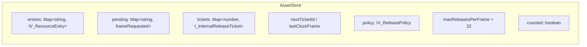
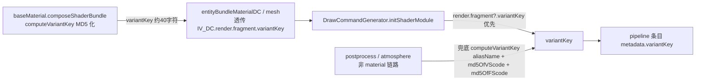
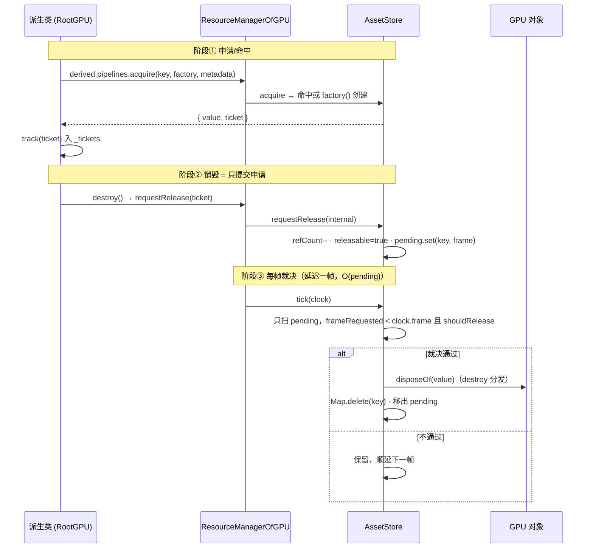
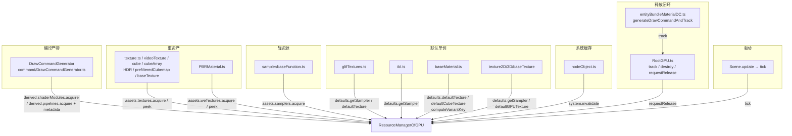

# GPU 资源管理器（ResourceManagerOfGPU）最终结构与设计总结

> 状态：**已落地**（commit `4f65b95`，2026-11-17）
> 前置方案：`GPU资源管理器全新设计与一次性替换方案-20261113.md`（契约定义）、`GPU资源管理器与mapList重构方案-20261113.md`（缺陷分析）
> 本文是最终代码结构的自包含快照 + 设计复盘，供后续维护与 A-Buffer 等新资源接入时参考。

---

## 一、定位

`ResourceManagerOfGPU` 取代旧的 25 个平铺 `Map` + 字符串反射（`getProperty` / `E_resourceKind`）的 GPU 资源管理器，收敛为**四个 Store + 一个门面**：

- 唯一对外入口 `scene.resourcesGPU`（`scene.ts:295` / `:532` 构造）。
- 对象侧（`RootGPU` 派生类）**零知识**：只持有不透明 `IV_ReleaseTicket`，销毁时只提交 `requestRelease(ticket)`，不碰 Map 名 / key / `Map.delete` / GPU `destroy()`。
- 释放决策全部下沉到 `ResourceManagerOfGPU` 内的**可插拔策略**。

---

## 二、文件清单与职责

源码目录 `src/we/core/resources/gpu/`（旁路新实现，通过 `scene.ts` 单点接入生产路径）：

| 文件 | 职责 |
| --- | --- |
| `types.ts` | 纯类型契约，零运行时逻辑：`T_cacheId`、`IV_ReleaseTicket` / `I_InternalReleaseTicket`、`I_AcquireResult`、`IV_ResourceEntry`（含 `metadata?`）、`I_CompiledMetadata`、`I_StoreStats`（含 `variants?`）、`I_FrameClock`、`IV_ReleasePolicy`、`I_ReleasableStore` |
| `resourceKeys.ts` | `normalizeKey`（任意 source → 稳定字符串 key）、`stableStringify`（复用 `command/stableStringify`，键排序）、`disposeOf`（按运行时形态分发销毁） |
| `shaderVariantKey.ts` | 编译产物三层 key 的**纯函数**：`computeFinalCodeHash` / `computeShaderModuleKey` / `computeVariantKey` / `computeReflectionSignature`（+ `T_shaderStage` / `I_ReflectionSignatureInput`） |
| `releasePolicy.ts` | 可插拔释放策略：`RefCountPolicy`（默认）、`LruPolicy`、`ImmediatePolicy` |
| `assetCache.ts` | 通用分区 `AssetStore<V>` + 重资产组装 `AssetCache`（textures / weTextures / samplers / materials） |
| `derivedCache.ts` | `DerivedCache`：编译产物分区（shaderModules / pipelines），默认 `LruPolicy(60)` |
| `systemCache.ts` | `SystemCache`：系统缓存分区（systemGroup / shadowmap）+ `invalidate()` 全清 |
| `defaultResources.ts` | `DefaultResources`：scene 级常驻单例（default 纹理 / defaultPBR / 3 preset sampler / oneStorageMatrix） |
| `resourcesGPU.ts` | `ResourceManagerOfGPU`：四 Store 组装门面 + `I_ResourcesGPUStats` + 对外 API |
| `index.ts` | 内部 barrel，仅供 `__tests__` 与切换单点 import；**不进入** `src/we/index.ts` 公共 API |

---

## 三、整体架构图

```mermaid
flowchart TD
    SCENE[Scene<br/>scene.ts:532 构造 / :816 每帧 tick] --> MGR[ResourceManagerOfGPU<br/>resourcesGPU.ts 唯一门面]

    MGR --> DEF[DefaultResources<br/>defaultResources.ts<br/>scene 级单例，counted=false，常驻]
    MGR --> AST[AssetCache<br/>assetCache.ts<br/>重资产 + 轻资源]
    MGR --> DRV[DerivedCache<br/>derivedCache.ts<br/>编译产物]
    MGR --> SYS[SystemCache<br/>systemCache.ts<br/>系统缓存]

    AST --> AST1[textures<br/>AssetStore&lt;GPUTexture&gt;<br/>counted=true · RefCountPolicy]
    AST --> AST2[weTextures<br/>AssetStore&lt;unknown&gt;<br/>counted=true]
    AST --> AST3[samplers<br/>AssetStore&lt;GPUSampler&gt;<br/>counted=false]
    AST --> AST4[materials<br/>AssetStore&lt;unknown&gt;<br/>counted=false]

    DRV --> DRV1[shaderModules<br/>AssetStore&lt;GPUShaderModule&gt;<br/>counted=true · LruPolicy 60]
    DRV --> DRV2[pipelines<br/>AssetStore&lt;GPURenderPipeline | GPUComputePipeline&gt;<br/>counted=true · LruPolicy 60]

    SYS --> SYS1[systemGroup<br/>AssetStore&lt;GPUBindGroup&gt;]
    SYS --> SYS2[shadowmap<br/>AssetStore&lt;GPUTexture&gt;]

    DEF --> DEF1[default / defaultCube GPUTexture + WE3D Texture]
    DEF --> DEF2[defaultPBR 材质]
    DEF --> DEF3[linear / nearest / cube 三 preset sampler]
    DEF --> DEF4[oneStorageMatrix GPUBuffer]

    AST1 & AST2 & AST3 & AST4 & DRV1 & DRV2 & SYS1 & SYS2 --> STORE[AssetStore&lt;V&gt;<br/>assetCache.ts 唯一分区实现]
    STORE --> POLICY[IV_ReleasePolicy<br/>RefCount / Lru / Immediate 可插拔]
    STORE --> KEYS[resourceKeys.ts<br/>normalizeKey / stableStringify / disposeOf]
    STORE --> TYPES[types.ts 类型契约]
    DRV1 & DRV2 --> VARKEY[shaderVariantKey.ts<br/>三层 key 纯函数]
```

**结构要点**：八个分区共用同一个 `AssetStore<V>` 实现，差异仅靠构造参数 `counted` 与 `policy` 表达；编译产物分区额外接 `shaderVariantKey` 三层 key。

---

## 四、四个 Store 契约

| Store | 持有什么 | 缓存判据 | 生命周期 |
| --- | --- | --- | --- |
| `DefaultResources` | 固定常量（default 纹理 / defaultPBR / sampler / oneStorageMatrix） | 无（不是缓存） | scene lifetime 常驻；`counted=false` 不参与引用计数，仅 `clean()` 全量清空 |
| `AssetCache` | `GPUTexture` / WE3D `Texture`（重）；`GPUSampler` / `BaseMaterial`（轻，`counted=false`） | `normalizeKey(source)` | `acquire → ticket`，`requestRelease → pending`，`tick` 裁决后 `disposeOf` |
| `DerivedCache` | `GPUShaderModule` / `GPURenderPipeline` / `GPUComputePipeline` | `stage + finalCodeHash`（shaderModule）/ descriptor 稳定序列化（pipeline） | **必须命中**；无 `destroy()` API，`invalidate(key)` 精确失效仅 `Map.delete`；`LruPolicy(60)` 延迟回收 |
| `SystemCache` | `GPUBindGroup` / `GPUTexture` | key 字符串 | 相机 / 灯光变化触发 `invalidate()`（`cleanSystemUniform()` 演化版） |

---

## 五、通用分区 AssetStore（唯一分区实现）

### 5.1 内部状态



`IV_ResourceEntry<V>` 承载：`value` / `refCount` / `releasable` / `lastUsedFrame` / `metadata?`（编译产物元数据）。

### 5.2 方法语义

| 方法 | 语义 |
| --- | --- |
| `acquire(source, factory, metadata?)` | 命中或创建；命中已标记释放条目时**撤销申请**（移出 pending、`releasable=false`、刷新 `lastUsedFrame`）；写入 / 命中刷新 `metadata`；返回 `{ value, ticket }` |
| `peek(source)` | 只读命中，不持票、不撤销 pending（非 entity 链路的快路径） |
| `has(source)` | 存在性判断 |
| `invalidate(source)` | 精确失效单条（`disposeOf` + `Map.delete` + 移出 pending） |
| `invalidateByVariant(variantKey)` | §2.4 ② 按变种精确失效：删除所有 `metadata.variantKey` 匹配条目，返回删除数 |
| `requestRelease(ticket)` | **只登记**：`refCount--`（counted）、`releasable=true`、`pending.set(key, frame)`、`ticket.released=true`；幂等 |
| `tick(clock)` | 每帧裁决：只扫 `pending`，`frameRequested < clock.frame`（延迟一帧）+ `policy.shouldRelease` 通过 → `disposeOf` + 删除；单帧 `maxReleasesPerFrame` 限流 |
| `clean()` | 全量清空：`policy.onSweep` + 逐条 `disposeOf` + 清空三张 Map |
| `stats()` | `{ size, totalRefs, variants? }`；`variants` 聚合 `metadata.variantKey` 计数 |

---

## 六、编译产物三层 key 契约（C4，最高优先级）

纯函数集中在 `shaderVariantKey.ts`：

| 层 | 函数 | 计算 | 作用 |
| --- | --- | --- | --- |
| ① 命中（唯一依据） | `computeFinalCodeHash(finalWGSL)` | `MD5(finalWGSL)` | 防碰撞最后一道闸，整条链完成后计算 |
| ② 变种标识 | `computeVariantKey(aliasName, userCode, userCodeFunction)` | `aliasName + ':' + MD5(userCode + '\0' + userCodeFunction)` | 可读 / `stats()` 按变种统计 / 按变种精确失效 |
| ③ 反射签名 | `computeReflectionSignature(input)` | `stableStringify(input)`（列表保序、保留大小写） | VS 专属，显式兜住 attribute 维度 |

**硬规则**（落地实现）：

- 命中只用 `stage + finalCodeHash`；VS / FS / CS 分前缀，`fragment.code === undefined` 不复用空串。
- `variantKey` / `reflectionSignature` 作为 `I_CompiledMetadata` 写入 **pipeline 条目**并进入 pipeline `keyObject`，但**不改变命中分区**（是 `finalCodeHash` 的冗余标签）。
- `variantKey` 是 `finalCodeHash` 的粗化函数（只区分 userCode/userFn，不区分 materialType / 反射）。
- 禁止 `aliasName` / 模板 code 单独作 key；反射占位符缺失由 `console.log` 改 `throw`（`applied=false` 且不缓存）。

### 6.1 variantKey 的 MD5 化透传（最终落地取舍）

`MD5(userCode + '\0' + userCodeFunction)` 的输入 `userCode` / `userCodeFunction` **只在 material 层存在**。为避免数百行 WGSL 跨 material → entity → `IV_DC` 复制：

1. **material 层就地 hash 化**：`baseMaterial.composeShaderBundle` 内 `computeVariantKey(aliasName, getUserCode(), getUserCodeFunction())`，写入 `I_materialBundleOutput.variantKey`；
2. **向下透传紧凑串**：`entityBundleMaterialDC.ts` / `mesh.ts` → `IV_DC.render.fragment.variantKey`（约 40 字符）；
3. **DCG 优先取透传值**：`DrawCommandGenerator.initShaderModule` 取 `render.fragment?.variantKey`，非 material 链路（postprocess / atmosphere 等）退回 `computeVariantKey(aliasName, md5OfVScode, md5OfFScode)` 兜底——注入后 code hash 是 userCode 的等价物（userCode 一变必然改变 finalWGSL → hash）。



---

## 七、释放生命周期（C5 / C6）

### 7.1 时序



### 7.2 可插拔策略

| 策略 | 释放条件 | 用途 |
| --- | --- | --- |
| `RefCountPolicy`（默认） | `releasable && refCount <= 0` | 重资产，共享资源不提前销毁 |
| `LruPolicy(ttl=60)` | `releasable && refCount <= 0 && frame - lastUsedFrame > ttl` | 编译产物，减少重编译抖动 |
| `ImmediatePolicy` | `releasable` | 显式强制场景，放弃引用计数保护 |

### 7.3 关键不变量

- `requestRelease` **绝不立即销毁**（幂等）；`tick` 是唯一每帧释放执行器。
- `tick` **只扫 pending**，不扫全部分区，复杂度 O(pending)。
- **延迟一帧**：`Scene.update()` 末尾（`scene.ts:816`）才调 `tick`，此时渲染阶段（`onAfterUpdate → render`）已结束，避免释放仍在使用的对象。
- `clean()` **仅「退出 / 显式强制清空」** 调用；resize / IBL / dispose 均不触发。
- `invalidate(key)` / `invalidateByVariant(variantKey)` / `system.invalidate()` 是精确失效，**不做全量清空**。

### 7.4 ticket 生命周期闭环


`valueDC.releaseTickets` 取走后置空，避免 `IV_DC` 被 `inputDC` 常驻时连带 ticket 常驻。

---

## 八、调用图（生产者 / 消费者）



### 调用点明细

| 调用方 | 分区 / API | 说明 |
| --- | --- | --- |
| `DrawCommandGenerator` | `derived.shaderModules.acquire`（`vs:${md5}` / `fs:${md5}`）、`derived.pipelines.acquire(key, factory, metadata)` / `peek` | 编译产物唯一生产入口；`metadata = { variantKey, reflectionSignature }` |
| 纹理类 ×8 | `assets.textures.peek` / `acquire(source, factory)` | 重资产，`ticket` 交 `RootGPU.track` |
| `PBRMaterial` | `assets.weTextures.peek` / `acquire` | WE3D 纹理 |
| `sampler/baseFunction` | `assets.samplers.acquire(descriptor, factory)` | 轻资源，`counted=false` |
| `baseMaterial` | `defaults.defaultTexture / defaultCubeTexture`；`computeVariantKey` | 默认单例 + 变种标识 |
| `texture2D/3D/baseTexture`、`gltfTextures`、`ibl` | `defaults.getSampler(...)` / `defaultGPUTexture` / `defaultTexture` | 3 preset sampler + 默认纹理 |
| `nodeObject` | `system.invalidate()` | shadowmap 数量变化时清空 system 分区 |
| `entityBundleMaterialDC` | `scope.track(ticket)` | derived ticket 生命周期闭环 |
| `RootGPU` | `track(ticket)` / `destroy() → requestRelease` | 所有派生类统一释放出口 |
| `Scene` | `new ResourceManagerOfGPU(this)` / `update() → tick(this.clock)` | 构造 + 帧级驱动 |
| `scene` 便捷方法 | `getResourceDefaultPBR / getResourceDefaultTexture / getResourceDefaultGPUTexture` | 默认资源对外访问 |

---

## 九、设计总结

### 9.1 核心设计决策

1. **单一分区实现 + 参数化**：`AssetStore<V>` 一个类同时服务重资产（counted）、轻资源（counted=false）、编译产物（Lru）与系统缓存，语义差异全靠 `counted` + `policy` 两个构造参数表达，避免为每种资源各写一个 Store（旧实现 25 个平铺 Map 的根因）。

2. **四层 Store 分权**：`defaults`（常驻单例）/ `assets`（重+轻）/ `derived`（编译产物）/ `system`（系统缓存）。**默认资源不进缓存**（不是 `AssetStore`，是固定字段），从语义上消灭了「default 纹理被误释放」这类边界问题。

3. **命中只用 `finalCodeHash`，元数据冗余不分区**：`variantKey` / `reflectionSignature` 进 `keyObject` 是为了「可读 / 统计 / 精确失效」，但**绝不参与命中分区**——避免引入新区分维度导致命中率下降或语义复杂化。这是「标签」与「主键」的严格分离。

4. **variantKey 在数据源头 MD5 化**：变种标识只在 material 层（userCode/userFn 唯一存在点）就地 hash 化，向下透传 40 字符紧凑串而非几百行 WGSL，兼顾「按定义计算」与「跨层成本」；非 material 链路用注入后 code hash 兜底（数学等价物）。

5. **释放 = 申请 + 延迟裁决分离**：对象侧 `destroy()` 只提交 `requestRelease`，真正是否/何时释放由策略在下一帧 `tick` 裁决。这拆掉了旧实现「回删 ≠ 释放」与「共享缓存被单方销毁」两个 P0 缺陷的根源。

6. **延迟一帧 + O(pending)**：`tick` 只扫 pending、`frameRequested < clock.frame`，且 `Scene.update()` 末尾才驱动，保证渲染阶段仍能安全使用、每帧开销有上界。

7. **可插拔策略**：`RefCountPolicy` / `LruPolicy` / `ImmediatePolicy` 互替换**不改任何派生类一行代码**；编译产物默认 `LruPolicy(60)` 用 TTL 延迟回收，减少重编译抖动。

8. **精确失效，无全清**：`invalidate(key)` / `invalidateByVariant(variantKey)` / `system.invalidate()` 三个入口，编译产物无 `destroy()` API，只删 Map 条目；`clean()` 仅「退出 / 强制清空」，resize / IBL 变化不触发。

9. **ticket 生命周期闭环**：DCG 在 `acquire` 时把 ticket 收集到 `valueDC.releaseTickets`，entity 层取走后 `track` 到自身 `_tickets`，销毁时统一 `requestRelease`；取走后置空避免 `IV_DC` 常驻导致 ticket 泄漏。

10. **可观测性**：`stats()` 按分区暴露 `size` / `totalRefs` / `variants`（编译产物按变种计数），`check()` 提供诊断占位；`variants` 直接支撑「同材质 N 实例只编译 1 次」的验收断言。

### 9.2 关键取舍记录

- **metadata 只写 pipeline 条目**：§2.4 ② 的「写入条目 + 进入 keyObject」语境指向 pipeline；shaderModule 未写 metadata，故 `invalidateByVariant` 只失效 pipeline，shaderModule 仍可命中复用、由引用计数回收。
- **`computeShaderModuleKey` / `computeFinalCodeHash` 已提供但 DCG 内联**：`shaderModules.acquire` 实际用内联 `vs:${md5OfVScode}` / `fs:${md5OfFScode}`，与 `computeShaderModuleKey(stage, finalCodeHash)` 数学等价（`md5OfVScode` / `md5OfFScode` 即注入后 code 的 finalCodeHash）。
- **reflectionSignature 字段收敛**：接口保留 `morphTargets` / `reflectionVersion`，DCG 当前只传 `{ names, locations, buffers, ndc, applied }`。
- **system 分区目前主要为骨架**：`systemGroup` / `shadowmap` 的生产 acquire 未完全迁移（shadowmap 死缓存按 D-4 结论清理），但 `system.invalidate()`（`nodeObject.ts:470`）已接生产，`cleanSystemUniform()` 语义由它承接。
- **`AssetCache.stats()` / `SystemCache.stats()` 返回 `{ size, totalRefs }`**（无 `variants`），`DerivedCache.stats()` 返回 `I_StoreStats`（含 `variants`）；`I_ResourcesGPUStats` 统一为 `I_StoreStats`（`variants` 可选，兼容二者）。

### 9.3 与旧实现对照

| 维度 | 旧实现 | 新实现 |
| --- | --- | --- |
| 存储 | 25 个平铺 `Map` + `E_resourceKind` 字符串反射 | 4 Store × 统一 `AssetStore` |
| 对象侧知识 | `mapList.push` + `destroy()` 回删 | 只持 `IV_ReleaseTicket` + `requestRelease` |
| 释放 | `Map.delete` 从不 `destroy()`（泄漏） | 策略裁决后 `disposeOf` 真释放 |
| 共享销毁 | `Texture._destroy()` 无条件直毁 | 引用计数，`refCount<=0` 才释放 |
| 编译产物 key | 仅 `MD5(code)`，无 stage 前缀 / 变种 / 反射 | 三层 key，命中只用 `stage + finalCodeHash` |
| 失效 | `clean()` 全清 | 精确失效 + `clean()` 仅退出/强制清空 |
| 观测 | 无 | `stats()` / `variants` / `check()` |

### 9.4 对外边界

- `src/we/index.ts` **一行未改**，`gpu/` 通过 `scene.resourcesGPU` 单点暴露，公共 API 面不变（`check:exports` 兜底）。
- `gpu/index.ts` 是内部 barrel，仅供测试与单点 import，不进入 curated barrel。
- A-Buffer 等**有所有权的新 GPU 资源**，未来必须走 `AssetStore.acquire/release`（或新增专用分区），**不得**回退到平铺 Map + 对象侧回删的老路。
